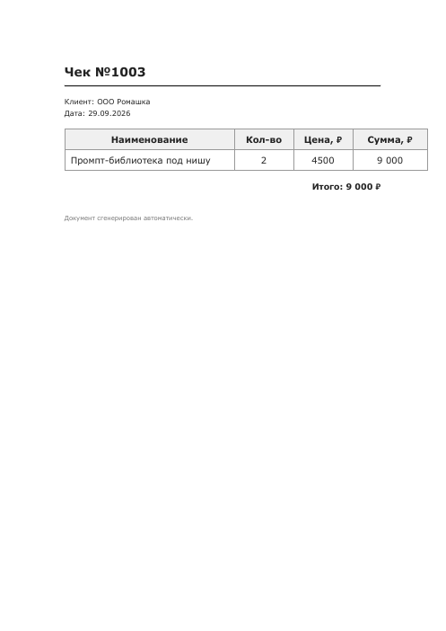

# PDF-генератор чеков

CLI-инструмент на Python: подставляет данные из CSV/JSON в HTML-шаблон и генерирует готовый PDF. Написан по методике курса Вайбкодер (составной промпт + генерация кода).

## Какую задачу решает
Чеки и счета набирались вручную в редакторе. Здесь данные лежат в таблице CSV, оформление в HTML-шаблоне, а готовый PDF получается одной командой. Данные в примерах вымышленные.

## Для кого
Самозанятый или небольшой бизнес, которому нужно быстро выдавать клиентам одинаково оформленные документы.

## Стек
Python 3, WeasyPrint, Jinja-подстановка в HTML-шаблон, CSV и JSON как источник данных.

## Как это выглядит


## Установка

```bash
python3 -m venv venv
source venv/bin/activate      # Windows: venv\Scripts\Activate.ps1
pip install -r requirements.txt
```

## Запуск

```bash
python3 pdf_generator.py
```

Скрипт покажет список файлов из `/data`, список шаблонов из `/templates`, даст выбрать конкретную запись (по `invoice_id`, если он есть в данных) и сгенерирует PDF в `/output`, который автоматически откроется в системном просмотрщике.

## Структура

```
pdf-generator/
├── pdf_generator.py
├── requirements.txt
├── data/
│   ├── invoices.csv      # с invoice_id, для выбора конкретного чека
│   └── products.csv      # простой вариант без invoice_id
├── templates/
│   └── invoice_simple.html
└── output/                # сюда сохраняются готовые PDF
```

## Промпт, который использовала

Финальный составной промпт (после пары итераций уточнения по методике урока: сначала базовая задача, потом добавлена конкретика про выбор файла/шаблона/записи и обработку кириллицы):

> Напиши CLI-инструмент на Python для генерации PDF из HTML-шаблона с помощью библиотеки WeasyPrint. Скрипт должен: читать все доступные CSV и JSON файлы в директории /data (CSV через pandas, JSON через стандартный json), читать все HTML-шаблоны из директории /templates, при запуске выводить список доступных файлов с данными и доступных шаблонов, давать пользователю выбрать через input один файл данных и один шаблон, если в данных есть invoice_id, выводить список записей по invoice_id и давать выбрать конкретную; подставлять данные в HTML-шаблон и сохранять PDF в /output; после генерации автоматически открывать PDF в системной программе просмотра. Обязательно: поддержка кириллицы без артефактов, аккуратный перенос длинных строк в таблице без поломки вёрстки, скрипт должен работать и на Windows, и на macOS (разные способы открытия файла и разные пути к venv).

## Что было учтено из типичных проблем (по чек-листу урока)

- **Кириллица**: шаблон явно объявляет `UTF-8`, HTML читается и пишется тоже в `UTF-8`, артефактов и «кракозябр» нет.
- **Длинные строки**: у ячейки товара `word-wrap` и `overflow-wrap`, у таблицы `table-layout: fixed` с фиксированными процентными ширинами колонок, поэтому длинное название переносится, а не ломает таблицу.
- **Windows vs macOS**: открытие PDF сделано через `platform.system()` (`open` на macOS, `os.startfile` на Windows, `xdg-open` на Linux).

## Офер для фриланс-биржи

Автоматизирую рутину с документами: настрою скрипт, который сам собирает чеки, акты и сертификаты из твоей CSV/Excel-таблицы или CRM и выдаёт готовый PDF за секунды, без опечаток и ручной работы. Подходит бизнесам, которые регулярно выставляют счета, выпускают сертификаты или готовят однотипную отчётность. Экономит часы ручного набора текста и убирает человеческий фактор: одна и та же форма, разные данные, ноль ошибок. Под ключ: разберу твой шаблон документа, настрою автогенерацию и сдам рабочий инструмент за 1-2 дня.
